# SRS Intelligence – Machine Learning-Based Software Requirement Specification Document Analysis and Parameter Identification


-blue)


> **SRS Intelligence** is a final-year academic project prototype. It reads a Software Requirement Specification (SRS) PDF, splits it into sentences, and uses a **TF-IDF + Linear Support Vector Machine** classifier to identify which of **eight requirement parameters** each sentence describes. Results appear in a responsive Flask dashboard with charts, a parameter view, model-performance pages and CSV/JSON exports. Everything runs locally; no external API or paid service is needed.

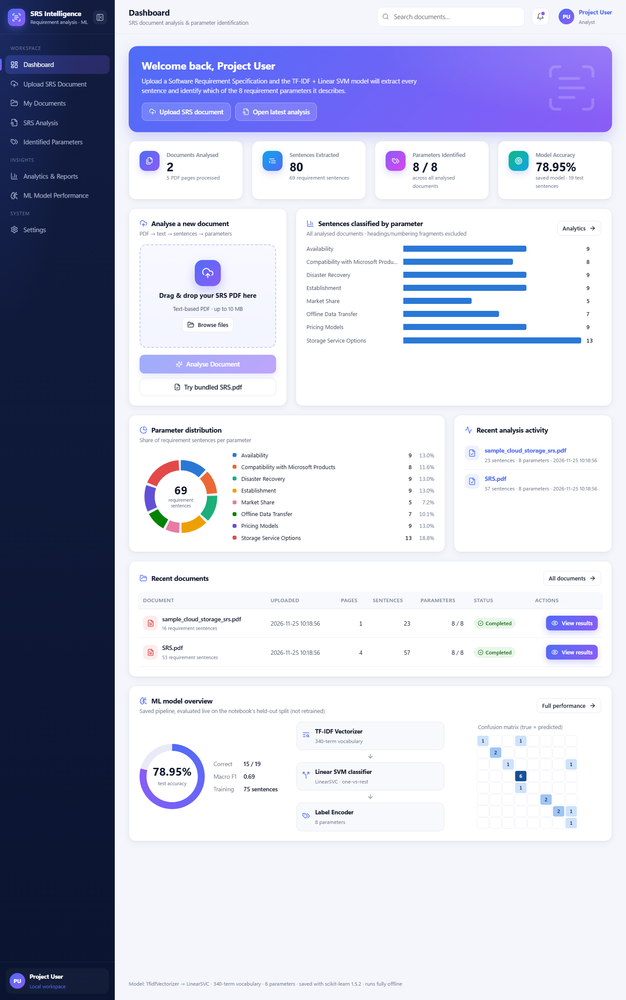

---

## Table of Contents

1. [Project Introduction](#1-project-introduction)
2. [Project Overview](#2-project-overview)
3. [Problem Statement](#3-problem-statement)
4. [Proposed Solution](#4-proposed-solution)
5. [Project Objectives](#5-project-objectives)
6. [Key Features](#6-key-features)
7. [Dashboard Screenshots](#7-dashboard-screenshots)
8. [Complete Project Workflow](#8-complete-project-workflow)
9. [System Architecture](#9-system-architecture)
10. [Machine Learning Methodology](#10-machine-learning-methodology)
11. [TF-IDF Explained](#11-tf-idf-explained)
12. [Linear SVM Explained](#12-linear-svm-explained)
13. [Dataset Description](#13-dataset-description)
14. [The Eight Classification Categories](#14-the-eight-classification-categories)
15. [Model Evaluation and Accuracy](#15-model-evaluation-and-accuracy)
16. [Dashboard Modules](#16-dashboard-modules)
17. [Technologies and Tools](#17-technologies-and-tools)
18. [System Requirements](#18-system-requirements)
19. [Project Folder Structure](#19-project-folder-structure)
20. [Installation](#20-installation)
21. [Python Environment Setup](#21-python-environment-setup)
22. [Dependency Installation](#22-dependency-installation)
23. [How to Run the Project](#23-how-to-run-the-project)
24. [How to Upload and Analyse an SRS PDF](#24-how-to-upload-and-analyse-an-srs-pdf)
25. [Sample Input and Output](#25-sample-input-and-output)
26. [Exporting Reports](#26-exporting-reports)
27. [Testing Instructions](#27-testing-instructions)
28. [Actual Test Results](#28-actual-test-results)
29. [API Requirements](#29-api-requirements)
30. [Known Limitations](#30-known-limitations)
31. [Future Enhancements](#31-future-enhancements)
32. [Academic Project Information](#32-academic-project-information)
33. [GitHub Repository Information](#33-github-repository-information)

---

## 1. Project Introduction

Software Requirement Specification documents are long, written in natural language, and must be read carefully to find out what a system has to provide. This project shows how a classical, lightweight machine-learning model can do that first reading automatically: it labels every sentence of an SRS with the requirement parameter it talks about. It also presents the result in an interactive dashboard that a student, reviewer or evaluator can use without any ML knowledge.

## 2. Project Overview

| Item | Value |
|---|---|
| Domain | SRS documents describing **cloud service providers** |
| Task | Sentence-level multi-class text classification (8 classes) |
| Model | `TfidfVectorizer` → `LinearSVC` (saved scikit-learn pipeline) |
| Training data | `Dataset.csv`, 94 labelled sentences |
| Reported accuracy | **78.95 %** on a 19-sentence held-out test set |
| Input | Text-based PDF |
| Output | Sentence table, identified parameters, charts, CSV / JSON exports |
| Interface | Flask dashboard *SRS Intelligence* (8 pages, collapsible sidebar, responsive) |
| External services | None required |

## 3. Problem Statement

Manually reading an SRS to find which requirements relate to availability, pricing, disaster recovery and similar concerns is slow, repetitive and error-prone, and two reviewers may classify the same sentence differently. A fast, consistent and repeatable way is needed to extract requirement sentences from an SRS PDF and map each one to a known evaluation parameter.

## 4. Proposed Solution

1. Extract the text of an uploaded SRS PDF with **PyMuPDF**.
2. Split the text into sentences with a regular expression.
3. Turn every sentence into numbers with **TF-IDF**.
4. Classify each sentence into one of eight parameters with a **Linear SVM** trained on labelled example sentences.
5. Show the results in a dashboard: counts per parameter, grouped sentences, a searchable table, model metrics and downloadable reports.

## 5. Project Objectives

- Automate sentence-level analysis of SRS documents.
- Identify eight cloud-service requirement parameters with a transparent, classical ML model.
- Report model quality honestly (accuracy, precision, recall, F1, confusion matrix).
- Provide an easy, offline web interface for uploading, analysing and exporting results.
- Keep the system light enough for an ordinary laptop (verified on 8 GB RAM).

## 6. Key Features

| Feature | Status |
|---|---|
| PDF upload by drag-and-drop or file browser, with real upload progress | ✅ |
| Text extraction (PyMuPDF) and sentence splitting | ✅ |
| Sentence classification into 8 parameters with the saved model | ✅ |
| SVM decision score per sentence (raw margin, **not** a probability) | ✅ |
| Identified-parameter view per document or across all documents | ✅ |
| Charts: bar chart, parameter-distribution donut, coverage heatmap, confusion matrix | ✅ |
| Live model evaluation page (78.95 % accuracy, per-class metrics) | ✅ |
| CSV, JSON, summary CSV and print / Save-as-PDF exports | ✅ |
| Document list with search and status | ✅ |
| Collapsible sidebar, mobile off-canvas menu, responsive layout | ✅ |
| Works offline, no API keys | ✅ |
| DOCX input, OCR for scanned PDFs, database, user login | ❌ Not implemented |
| Gemini chatbot | Separate optional app in `srs-chatbot/`, **not** part of the dashboard |

## 7. Dashboard Screenshots

All screenshots are real captures of the running application, analysing the bundled `SRS.pdf` and `samples/sample_cloud_storage_srs.pdf`.

| Dashboard | Upload SRS Document |
|---|---|
|  | 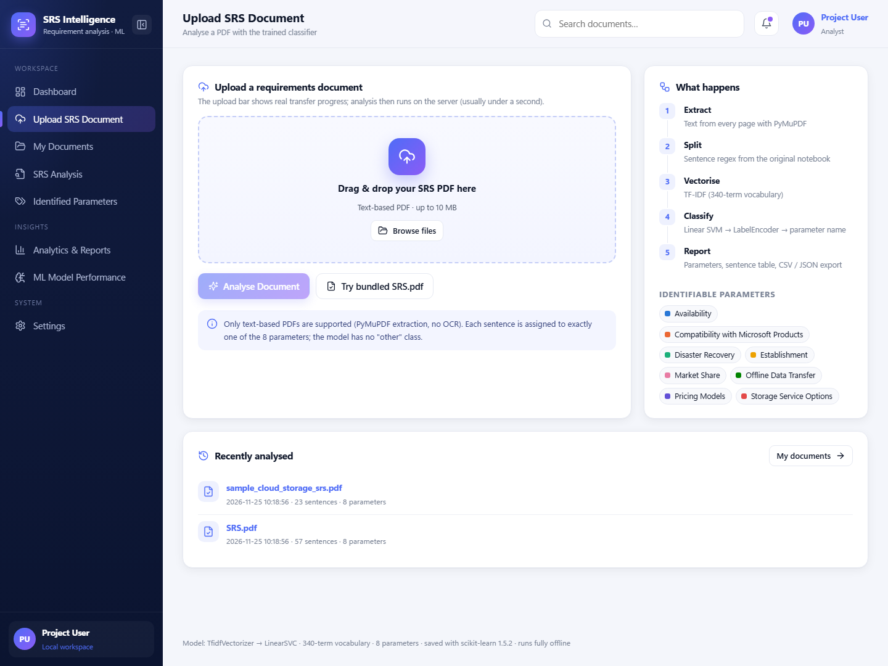 |
| **My Documents** | **SRS Analysis** |
| 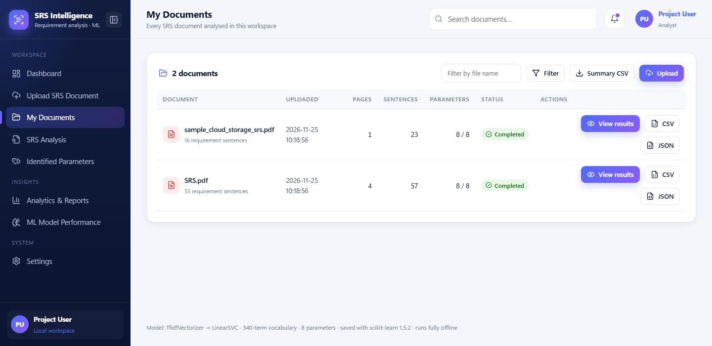 | 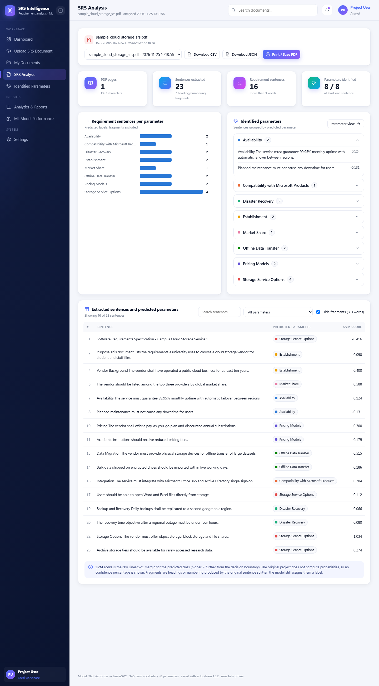 |
| **Identified Parameters** | **Analytics & Reports** |
| 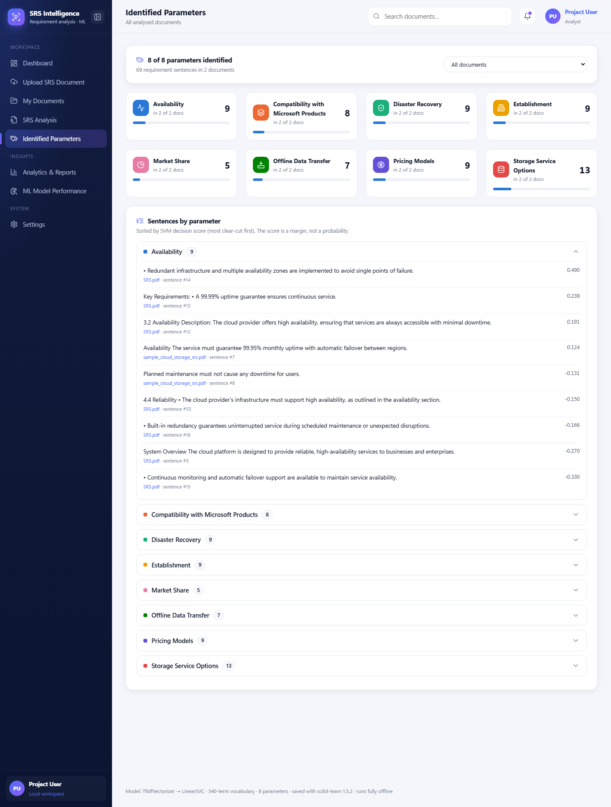 | 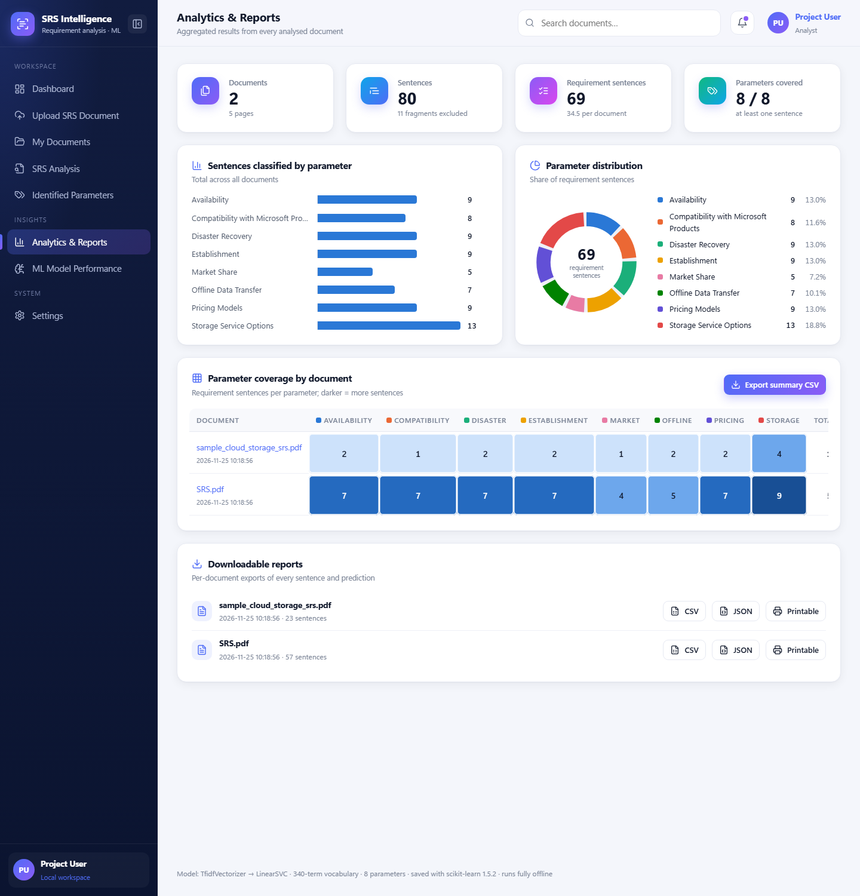 |
| **ML Model Performance** | **Settings** |
| 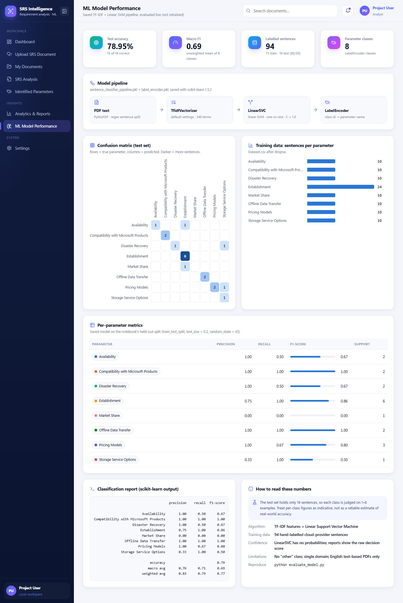 | 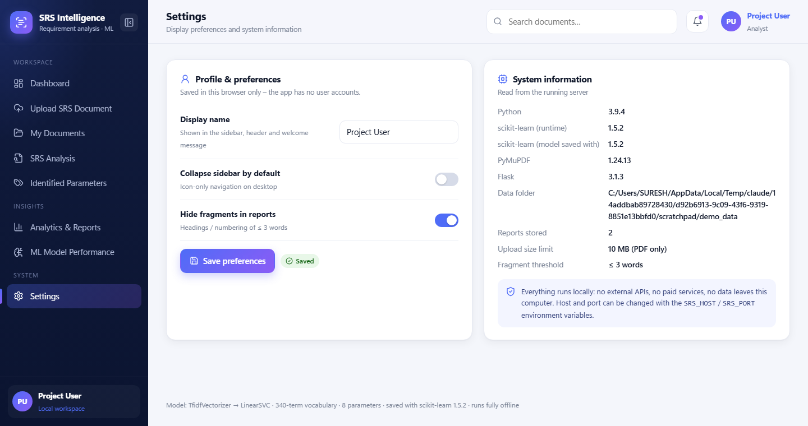 |

| Mobile layout (390 px) | Mobile menu | Collapsed sidebar |
|---|---|---|
| 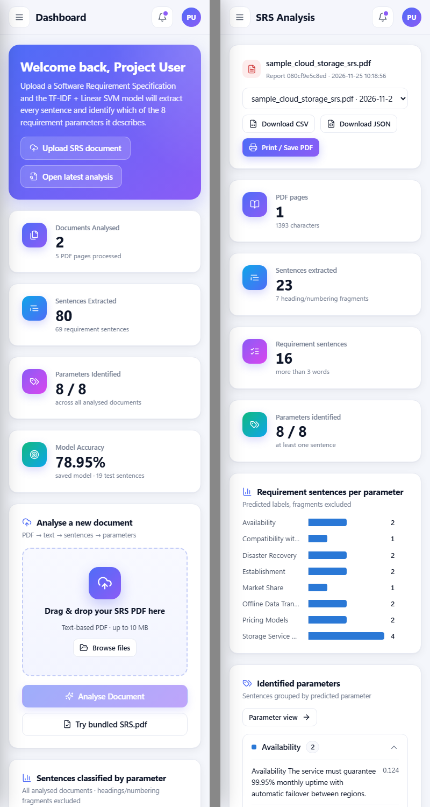 | 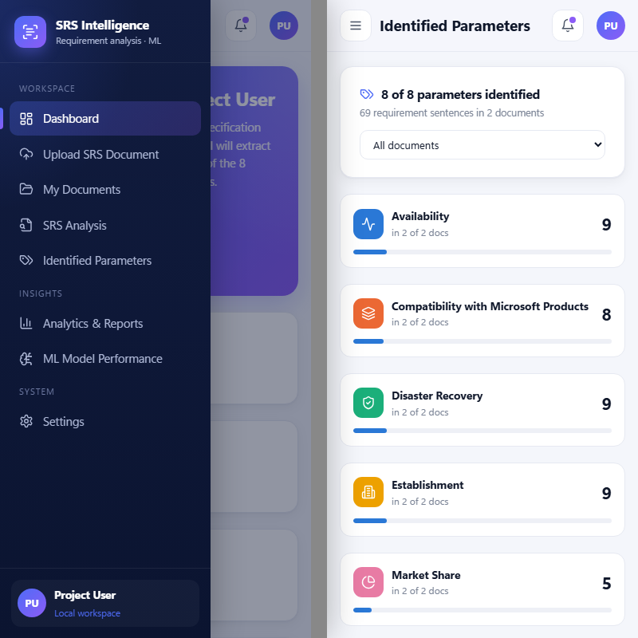 | 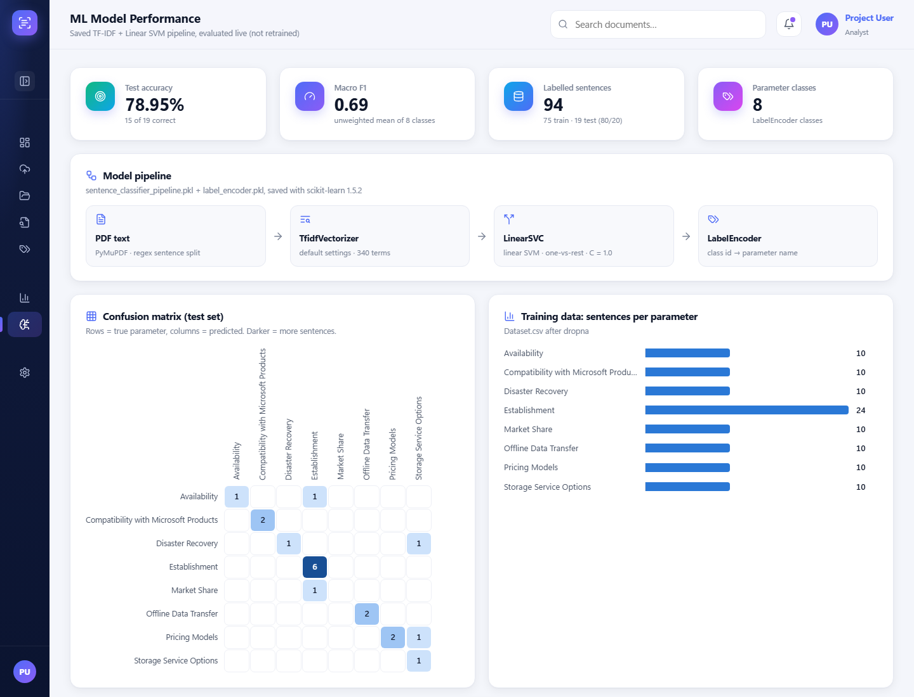 |

## 8. Complete Project Workflow

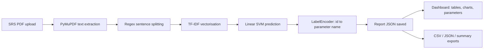

**Training (done once, in the original notebook `Final.ipynb`):**
`Dataset.csv → dropna → LabelEncoder → train_test_split(80/20, random_state=42) → TF-IDF + LinearSVC → evaluate → joblib.dump`

## 9. System Architecture

```
┌──────────────────────── Browser ────────────────────────┐
│  SRS Intelligence UI (HTML, CSS, vanilla JS, Lucide)    │
└───────────────┬─────────────────────────────────────────┘
                │ HTTP (multipart upload, page requests)
┌───────────────▼──────────── Flask (dashboard/app.py) ───┐
│ Routes: / /upload /documents /analysis /report/<id>     │
│         /parameters /analytics /model /settings         │
│         POST /analyze, CSV/JSON/summary exports, /health│
└───────┬──────────────────────────────┬──────────────────┘
        │                              │
┌───────▼──────── srs_classifier.py ───┐   ┌──────────────▼───────────┐
│ extract_pdf_text (PyMuPDF)           │   │ Report store (JSON files) │
│ preprocess_text (regex)              │   │ dashboard/reports/        │
│ SRSClassifier (joblib .pkl models)   │   └───────────────────────────┘
└───────┬──────────────────────────────┘
┌───────▼──────────────────────────────────────────────────┐
│ sentence_classifier_pipeline.pkl  (TF-IDF + LinearSVC)    │
│ label_encoder.pkl                 (8 parameter names)     │
└──────────────────────────────────────────────────────────┘
```

## 10. Machine Learning Methodology

| Step | Implementation (verified in source) |
|---|---|
| Data cleaning | `pandas.read_csv("Dataset.csv").dropna()`, 95 → 94 rows |
| Label encoding | `sklearn.preprocessing.LabelEncoder` |
| Split | `train_test_split(test_size=0.2, random_state=42)`, 75 train / 19 test |
| Features | `TfidfVectorizer()` with default settings, 340-term vocabulary |
| Classifier | `LinearSVC()` with defaults (C = 1.0, one-vs-rest) |
| Pipeline | `make_pipeline(TfidfVectorizer(), LinearSVC())` |
| Persistence | `joblib.dump` → `sentence_classifier_pipeline.pkl`, `label_encoder.pkl` (scikit-learn **1.5.2**) |
| Inference | PDF → sentences → `pipeline.predict` → `label_encoder.inverse_transform` |

The saved model is used **unchanged**; this repository does not retrain it.

## 11. TF-IDF Explained

Computers cannot read words, so each sentence is turned into a list of numbers.
**TF-IDF (Term Frequency – Inverse Document Frequency)** gives each word a weight:

- **TF**: how often the word appears in this sentence.
- **IDF**: how rare the word is across all training sentences. Common words like "the" get a low weight; distinctive words like "uptime", "subscription" or "replication" get a high weight.

The result is a 340-number vector per sentence, in which the most informative words stand out.

## 12. Linear SVM Explained

A **Support Vector Machine** learns a boundary (a hyperplane) that separates examples of one class from the others, placing it as far as possible from the nearest examples. `LinearSVC` trains one such boundary per parameter (one-vs-rest). For a new sentence it computes a score for every parameter and picks the highest.

The dashboard shows that winning score as the **SVM score**. A higher score means the sentence lies further from the decision boundary. **It is not a probability or a confidence percentage**: `LinearSVC` does not produce probabilities and the project does not calibrate them.

## 13. Dataset Description

| Property | Value |
|---|---|
| File | `Dataset.csv` |
| Columns | `Sentence`, `Label` |
| Rows | 95 (one empty row) → **94 usable sentences** |
| Classes | 8 |
| Domain | Statements about cloud service providers |
| Balance | Establishment 24 sentences; every other class 10 |

## 14. The Eight Classification Categories

Class names read directly from `label_encoder.pkl` (`label_encoder.classes_`):

| ID | Parameter | Meaning | Example training sentence |
|---|---|---|---|
| 0 | **Availability** | Uptime, redundancy, failover | "The service guarantees 99.99% uptime, ensuring minimal downtime." |
| 1 | **Compatibility with Microsoft Products** | Office, Azure AD, Windows Server integration | "The cloud platform is compatible with Microsoft Office tools." |
| 2 | **Disaster Recovery** | Backups, replication, recovery plans | "Disaster recovery features include real-time data replication." |
| 3 | **Establishment** | Company history, reputation, experience | "The cloud provider has been established in the industry for over a decade." |
| 4 | **Market Share** | Market position and growth | "The cloud provider holds a significant share of the global market." |
| 5 | **Offline Data Transfer** | Physical devices, bulk shipping of data | "Data transfer can be completed offline via physical storage devices." |
| 6 | **Pricing Models** | Pay-as-you-go, subscriptions, discounts | "The platform supports pay-as-you-go pricing and reserved instances." |
| 7 | **Storage Service Options** | Object/block/file storage, tiers | "The platform supports object, block, and file storage services." |

## 15. Model Evaluation and Accuracy

Evaluated live by `evaluate_model.py` on the original notebook's held-out split. The result is identical to the notebook's recorded output.

| Metric | Value |
|---|---|
| **Accuracy** | **78.95 %** (15 of 19 test sentences correct) |
| Macro F1 | 0.69 |
| Weighted F1 | 0.77 |

| Parameter | Precision | Recall | F1 | Support |
|---|---|---|---|---|
| Availability | 1.00 | 0.50 | 0.67 | 2 |
| Compatibility with Microsoft Products | 1.00 | 1.00 | 1.00 | 2 |
| Disaster Recovery | 1.00 | 0.50 | 0.67 | 2 |
| Establishment | 0.75 | 1.00 | 0.86 | 6 |
| Market Share | 0.00 | 0.00 | 0.00 | 1 |
| Offline Data Transfer | 1.00 | 1.00 | 1.00 | 2 |
| Pricing Models | 1.00 | 0.67 | 0.80 | 3 |
| Storage Service Options | 0.33 | 1.00 | 0.50 | 1 |

> ⚠️ The test set holds only **19 sentences** (1–6 per class), so these numbers are indicative for an academic prototype. They are **not** an estimate of production-level performance.

## 16. Dashboard Modules

| Sidebar page | Route | What it shows |
|---|---|---|
| Dashboard | `/` | Welcome banner; cards for documents analysed, sentences extracted, parameters identified and model accuracy; upload card; bar and donut charts; recent activity; recent documents; ML overview |
| Upload SRS Document | `/upload` | Drag-and-drop upload, upload progress, analysis steps, list of identifiable parameters |
| My Documents | `/documents` | All analysed documents with search, status, view, CSV/JSON, summary CSV |
| SRS Analysis | `/analysis` → `/report/<id>` | Statistics, per-parameter chart, grouped parameters, filterable sentence table, exports, print |
| Identified Parameters | `/parameters?doc=<id>` | 8 parameter cards; sentences per parameter sorted by SVM score, for one or all documents |
| Analytics & Reports | `/analytics` | Aggregate charts, document × parameter heatmap, download centre |
| ML Model Performance | `/model` | Accuracy, macro F1, pipeline, confusion matrix, per-class metrics, scikit-learn report |
| Settings | `/settings` | Display name and display preferences (stored in the browser), live system information |

The app has no user accounts. The profile name ("Project User" by default) is set in Settings and stored only in the browser.

## 17. Technologies and Tools

| Category | Tools |
|---|---|
| Language | Python 3.9 (verified), HTML5, CSS3, JavaScript |
| Machine learning | scikit-learn 1.5.2, NumPy 1.26.4, SciPy 1.13.1, pandas 2.2.3, joblib |
| PDF processing | PyMuPDF 1.24.13 |
| Web framework | Flask 3.1 (Jinja2 templates) |
| UI | Custom CSS design system, Lucide icons 0.460.0 (vendored locally), CSS/SVG charts |
| Testing | unittest / pytest (17 tests) |
| Original research | Google Colab notebook `Final.ipynb` |
| Optional chatbot | LangChain, HuggingFace embeddings, FAISS, Google Gemini (`srs-chatbot/`, separate) |

## 18. System Requirements

| Requirement | Minimum |
|---|---|
| OS | Windows 10/11, Linux or macOS |
| Python | **3.9 – 3.12** (scikit-learn 1.5.2 has no wheels for 3.13+) |
| RAM | 4 GB (verified on an 8 GB laptop; the dashboard uses about 150 MB) |
| Disk | About 300 MB including the virtual environment |
| Browser | Any modern browser (Chrome, Edge, Firefox) |
| Internet | Only for the first `pip install` |

## 19. Project Folder Structure

```
├── Dataset.csv                         # 94 labelled training sentences
├── Final.ipynb / final.py              # original Colab training + PDF classification code
├── sentence_classifier_pipeline.pkl    # saved TF-IDF + LinearSVC pipeline (sklearn 1.5.2)
├── label_encoder.pkl                   # saved LabelEncoder (8 parameter names)
├── SRS.pdf                             # bundled sample SRS document
├── srs_classifier.py                   # PDF extraction, sentence splitting, classification
├── run_analysis.py                     # command-line PDF analysis
├── evaluate_model.py                   # evaluates the saved model (no retraining)
├── requirements.txt                    # verified dependencies
├── requirements-chatbot.txt            # optional, unverified chatbot dependencies
├── dashboard/
│   ├── app.py                          # Flask application (routes, aggregation, exports)
│   ├── templates/                      # base, macros, 8 page templates, report, empty
│   └── static/                         # dashboard.css, vendor/lucide.min.js
├── samples/                            # demo PDF not in the training data + its generator
├── tests/test_project.py               # 17 unit / integration tests
├── docs/screenshots/                   # real application screenshots
├── srs-chatbot/                        # original Gemini RAG chatbot (separate, optional)
├── PROJECT_ANALYSIS.md                 # technical analysis
├── SETUP_GUIDE.md                      # detailed setup guide
├── EXECUTION_REPORT.md                 # execution and verification log
├── Code simple explanation for Srs analysis.pdf
├── Workflow.svg
└── LICENSE
```

`dashboard/reports/` and `dashboard/uploads/` are created at runtime and are git-ignored.

## 20. Installation

```powershell
git clone https://github.com/nnaidev02Amer/Software-Requirement-Specification-Document-Analysis-and-Parameter-59.git
cd Software-Requirement-Specification-Document-Analysis-and-Parameter-59
```

## 21. Python Environment Setup

```powershell
# check which Python versions are installed (need 3.9 – 3.12)
py -0

# create an isolated virtual environment
py -3.9 -m venv .venv
```

On Linux / macOS: `python3.9 -m venv .venv`, then use `.venv/bin/python` in place of `.\.venv\Scripts\python.exe`.

## 22. Dependency Installation

```powershell
.\.venv\Scripts\python.exe -m pip install --no-cache-dir --timeout 120 --retries 10 -r requirements.txt
```

`scikit-learn==1.5.2` is pinned because the saved model files were created with that exact version.

## 23. How to Run the Project

```powershell
.\.venv\Scripts\python.exe dashboard\app.py
```

Open **http://127.0.0.1:5000** in your browser. Stop the server with `Ctrl + C`.

Optional settings: `$env:SRS_PORT = "5050"` (port), `$env:SRS_HOST`, `$env:SRS_DATA_DIR` (folder for reports and uploads).

Command-line alternatives:

```powershell
.\.venv\Scripts\python.exe run_analysis.py                       # analyse the bundled SRS.pdf
.\.venv\Scripts\python.exe run_analysis.py my_srs.pdf --csv out.csv
.\.venv\Scripts\python.exe evaluate_model.py                     # print accuracy, report, confusion matrix
```

## 24. How to Upload and Analyse an SRS PDF

1. Open **Upload SRS Document** in the sidebar (or use the upload card on the Dashboard).
2. Drag a PDF onto the drop zone, or click **Browse files**.
3. Click **Analyse Document**. The progress bar shows the upload, then the server extracts, splits and classifies the text.
4. You are taken to the **SRS Analysis** report:
   - cards for pages, sentences, requirement sentences and parameters identified,
   - a bar chart of sentences per parameter,
   - collapsible groups of sentences per parameter,
   - a searchable, filterable table of every sentence with its predicted parameter and SVM score.
5. Use **Identified Parameters** and **Analytics & Reports** to compare documents.

No PDF at hand? Click **Try bundled SRS.pdf**.

> Only text-based PDFs work. Scanned images contain no extractable text (no OCR), and DOCX is not supported.

## 25. Sample Input and Output

**Input:** `samples/sample_cloud_storage_srs.pdf`. This is a 1-page SRS written for the demo; none of its sentences are in the training data.

**Output (actual model predictions):** 23 sentences extracted, 16 requirement sentences, 8 / 8 parameters identified.

| # | Sentence | Predicted parameter | SVM score |
|---|---|---|---|
| 5 | The vendor should be listed among the top three providers by global market share. | Market Share | 0.588 |
| 7 | Availability The service must guarantee 99.95% monthly uptime with automatic failover between regions. | Availability | 0.124 |
| 10 | Pricing The vendor shall offer a pay-as-you-go plan and discounted annual subscriptions. | Pricing Models | 0.300 |
| 13 | Data Migration The vendor must provide physical storage devices for offline transfer of large datasets. | Offline Data Transfer | 0.515 |
| 16 | Integration The service must integrate with Microsoft Office 365 and Active Directory single sign-on. | Compatibility with Microsoft Products | 0.304 |
| 17 | Users should be able to open Word and Excel files directly from storage. | Storage Service Options ❗ | 0.112 |
| 20 | The recovery time objective after a regional outage must be under four hours. | Disaster Recovery | 0.080 |
| 22 | Storage Options The vendor must offer object storage, block storage and file shares. | Storage Service Options | 1.034 |

13 of the 14 section sentences received the label of the section they were written for. Sentence 17 (marked ❗) was intended as *Compatibility with Microsoft Products*.

For the bundled `SRS.pdf` (4 pages, 57 sentences), the local predictions are identical to the original notebook's printed output; an automated test checks this.

## 26. Exporting Reports

| Export | Where | Content |
|---|---|---|
| **CSV** | Report page, My Documents, Analytics | `#, sentence, predicted_parameter, svm_decision_score, word_count, is_fragment` |
| **JSON** | Report page, My Documents, Analytics | Full report: metadata, counts, grouped parameters, all predictions |
| **Summary CSV** | My Documents, Analytics | One row per document with sentence counts per parameter |
| **Print / Save PDF** | Report page | Browser print with a print-optimised layout |

Direct URLs: `/report/<id>/download.csv`, `/report/<id>/download.json`, `/reports/summary.csv`.

## 27. Testing Instructions

```powershell
.\.venv\Scripts\python.exe -m pip install pytest      # optional; unittest also works
.\.venv\Scripts\python.exe -m pytest -v
# or
.\.venv\Scripts\python.exe -m unittest discover -s tests -v
```

Tests write uploads and reports to a temporary folder, not to `dashboard/`.

## 28. Actual Test Results

`python -m pytest -v` → **17 passed, 0 failed** (Python 3.9.4, Windows 11).

| Group | Tests |
|---|---|
| Files & dependencies | required files exist · imports · pickle sklearn version matches runtime · dataset shape (94 rows, 8 classes) |
| Model | pipeline is TF-IDF → LinearSVC · reproduces **78.95 %** · sentence splitter · known sentence classified · **all 57 SRS.pdf predictions match the original notebook output** |
| Dashboard | pages render · every sidebar page has an active nav item · dashboard numbers equal backend aggregates · PDF upload end-to-end · CSV / JSON / summary CSV · non-PDF rejected · unknown report → 404 · `/analysis` redirect |

The only warnings are harmless SWIG `DeprecationWarning`s from PyMuPDF.

## 29. API Requirements

**The main SRS Intelligence dashboard needs no API keys, accounts or internet connection.** All analysis uses the local `.pkl` model files.

The repository also contains the original **`srs-chatbot/`**, a separate LangChain + Google Gemini question-answering app over PDFs. It:
- is **not connected** to the dashboard or the classifier,
- needs a Google AI Studio API key (the file contains only the placeholder `"Your_API_Key"`),
- uses the model name `gemini-pro`, which has been retired and must be updated,
- requires about 1.5–2 GB of extra packages (PyTorch). See `requirements-chatbot.txt` and [SETUP_GUIDE.md](SETUP_GUIDE.md#7-optional-original-gemini-chatbot-not-verified).

It was not run during verification.

## 30. Known Limitations

- **Small, single-domain dataset:** 94 sentences about cloud providers, so results on other kinds of SRS will be weak.
- **Small test set:** the 78.95 % figure comes from only 19 sentences.
- **No "other" class:** every sentence, including titles and security or usability requirements, is forced into one of the 8 parameters.
- **Sentence splitting:** the original regex leaves numbering fragments ("2.") and merges headings into sentences. The dashboard flags fragments of 3 words or fewer and hides them by default.
- **No probabilities:** the SVM score is a margin, not a confidence percentage.
- **Input:** PDF only; no DOCX and no OCR for scanned documents.
- **Storage:** reports are JSON files; there is no database and no user authentication.
- Parameter **values** (e.g. "99.99 %") are not extracted; only the category is predicted.

## 31. Future Enhancements

- Larger, multi-domain labelled dataset and k-fold cross-validation.
- An "Other / Not a requirement" class and functional / non-functional classification.
- Calibrated probabilities (e.g. `CalibratedClassifierCV`) for real confidence scores.
- Better sentence segmentation (spaCy) and heading detection.
- DOCX support and OCR (Tesseract) for scanned PDFs.
- Extraction of parameter values (numbers, SLAs, prices).
- Comparison of TF-IDF + SVM with transformer models (e.g. BERT).
- Database storage, user accounts and multi-user projects.
- Linking the chatbot to classified results as an optional assistant.

## 32. Academic Project Information

| Item | Detail |
|---|---|
| Type | Final-year academic project prototype |
| Title | SRS Intelligence – ML-Based SRS Document Analysis and Parameter Identification |
| Area | Machine Learning · Natural Language Processing · Software Engineering |
| Original work | ML notebook, dataset, trained model and chatbot from the original repository by **Prem954** ([source](https://github.com/Prem954/Software-Requirement-Specification-Document-Analysis-and-Parameter-Identification-Using-ML)) |
| This version adds | Local run scripts, model evaluation script, SRS Intelligence dashboard, tests and documentation; the ML methodology is unchanged |
| License | MIT (see [LICENSE](LICENSE)) |

Further documentation: [PROJECT_ANALYSIS.md](PROJECT_ANALYSIS.md) · [SETUP_GUIDE.md](SETUP_GUIDE.md) · [EXECUTION_REPORT.md](EXECUTION_REPORT.md) · `Code simple explanation for Srs analysis.pdf`

## 33. GitHub Repository Information

| Item | Value |
|---|---|
| Repository | [nnaidev02Amer/Software-Requirement-Specification-Document-Analysis-and-Parameter-59](https://github.com/nnaidev02Amer/Software-Requirement-Specification-Document-Analysis-and-Parameter-59) |
| Clone | `git clone https://github.com/nnaidev02Amer/Software-Requirement-Specification-Document-Analysis-and-Parameter-59.git` |
| Default branch | `main` |
| History | Includes the original repository's commits, followed by the SRS Intelligence work |

---

<p align="center"><i>Automating the first read of an SRS, one requirement at a time.</i></p>
